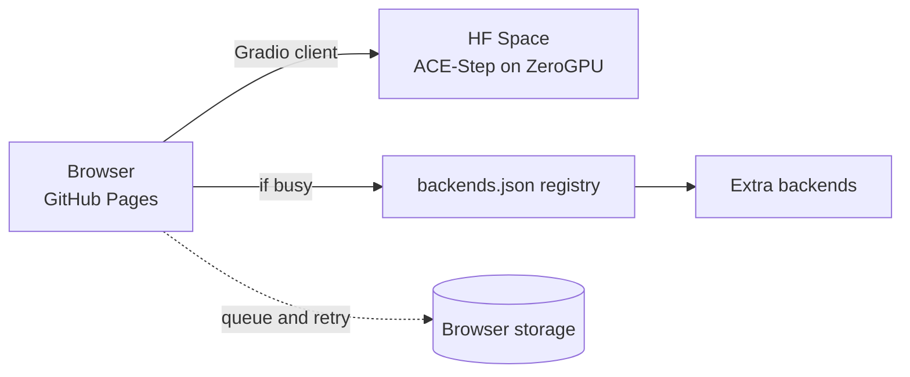

# AkStudioFreeai

Free AI music studio that runs in your browser. Describe a song, add lyrics, and generate music with an open-source model, with no sign-up.

**Live:** https://akingstar.github.io/AkStudioFreeai/

## Features

- Text-to-music with [ACE-Step](https://github.com/ace-step/ACE-Step) running on a Hugging Face Space (ZeroGPU)
- Custom lyrics or instrumental mode, style, mood and language controls
- Fast mode for quicker generation, MP3 download
- Automatic backend fallback with a queue that retries when quota returns
- Local project library (saved in your browser, JSON export)
- Voice dataset recorder with ZIP export
- Voice conversion pipeline (experimental, see below)

## How it works



The site is a static Vite app. The model runs on the backend Space, and the browser calls its `/generation_api` endpoint.

## Voice conversion (experimental)

Song vocals can be separated (Demucs), converted to a reference voice (Seed-VC) and mixed back. This runs as a GitHub Actions workflow on CPU, so it is slow. It lives in a separate private repository so that voice samples are never published.

## Limits

- Free ZeroGPU gives each visitor a small daily quota. When it runs out, the song is queued and retried.
- Songs are capped at 60 seconds in the web UI.
- Quality depends on the underlying open-source models.

## Responsible use

Use only your own voice, or a voice you have explicit permission to use. Do not impersonate real people. Label AI-generated music as AI-generated when you publish it.

## Development

```bash
npm install
npm run dev      # local dev server
npm run build    # production build
npm run deploy   # publish to GitHub Pages (gh-pages branch)
```

## Credits

[ACE-Step](https://github.com/ace-step/ACE-Step), [Gradio](https://www.gradio.app/), [Demucs](https://github.com/facebookresearch/demucs), [Seed-VC](https://github.com/Plachtaa/seed-vc), [Vite](https://vite.dev/).

## License

MIT, see [LICENSE](LICENSE). Third-party models and tools keep their own licenses.
