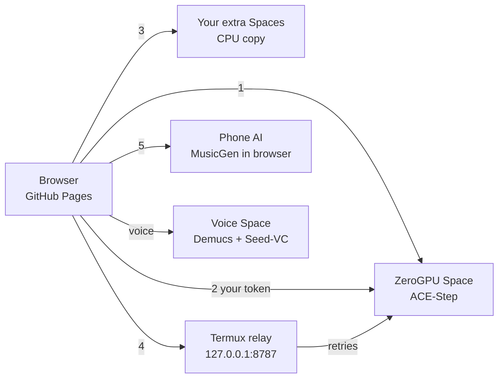

# AkStudioFreeai Pro

Free AI music studio in your browser: text-to-music, **built-in voice cloning**, library, mixing and mastering tools. Runs on GitHub Pages; heavy AI runs on free Hugging Face GPUs, with automatic fallbacks and a Termux (phone) relay.

**Live:** https://akingstar.github.io/AkStudioFreeai/

## What's new in Pro

- **Voice Clone page (built in):** record 10–25 s of your voice (or upload), save it, then pick *My cloned voice* on Create Music. Pipeline: ACE-Step song → Demucs vocal split → Seed-VC zero-shot singing conversion → mix. No training step. Compare *Original* vs *My voice*.
- **Quota-proof generation chain:** ZeroGPU → your own HF account (free token, separate quota) → your extra Spaces (e.g. CPU copy) → **Termux relay** on your phone (persistent queue, retries even when the browser is closed) → **Phone AI** in the browser (MusicGen-small, instrumental, experimental).
- **Connections page:** HF token, relay URL, voice backend, extra backends, live status dots, one-line Termux setup.
- **Generated songs saved in your library** (IndexedDB), downloadable even after the cloud link expires.
- Cleaner navigation (no floating buttons), animated player, lazy-loaded tools for faster first load, sensible default song length (1 min).

## Architecture



## Setup from Termux (one command)

Put `AkStudioFreeai-pro.zip` in your phone Downloads, then:

```bash
termux-setup-storage; cd ~ && unzip -o ~/storage/downloads/AkStudioFreeai-pro.zip -d ~ && bash ~/AkStudioFreeai/termux/install.sh
```

Then:

```bash
ak token hf_xxxxxxxx        # free HF token (use a WRITE token if you want ak space ...)
ak space voice              # deploy the voice-clone Space to your HF account (free)
ak push "AkStudio pro"      # push to GitHub; Actions deploys the site
ak status                   # relay check;  ak help for everything
```

If the folder is not yet a git clone: `cd ~/AkStudioFreeai && git init -b main && git remote add origin https://github.com/akingstar/AkStudioFreeai.git && git pull origin main --allow-unrelated-histories`.

## Voice clone, step by step

1. Open **Voice Clone**, record or upload 10–25 s of clean voice, tick the consent box, save.
2. **Create Music** → Vocal direction → Voice → *My cloned voice* → Generate. The song is made, then converted to your voice automatically.
3. Or use *Gaana/vocal apni awaaz me badlo* on the Voice Clone page to convert any song or acapella.

Voice backends: your own Space (`ak space voice`; free CPU works but is slow, GPU is fast) or the official `Plachta/Seed-VC` Space (acapella only).

## Honest limits

- "Unlimited free" is not possible: free GPUs have quotas. This project maximises them (own token, fallbacks, queue) but cannot remove them.
- ACE-Step cannot run on a phone CPU. The Termux relay does not generate music itself; it queues, retries, rotates through your configured backends and normalises loudness with ffmpeg. Phone AI is a small instrumental-only model and needs a recent phone.
- Voice cloning on free CPU Spaces takes minutes per song. Quality depends on the reference recording and on Seed-VC.
- The voice Space and the Phone AI path need first-run testing on your accounts; see `spaces/ak-voice`.

## Responsible use

Use only your own voice or a voice you have explicit permission to use. Do not impersonate real people. Label AI-generated music as AI-generated when you publish it.

## Development

```bash
npm install
npm run dev       # local dev server
npm run build     # production build
npm run relay     # run the relay without the ak command
```

## Credits

[ACE-Step](https://github.com/ace-step/ACE-Step), [Seed-VC](https://github.com/Plachtaa/seed-vc) (GPL-3.0), [Demucs](https://github.com/facebookresearch/demucs), [Gradio](https://www.gradio.app/), [transformers.js](https://github.com/huggingface/transformers.js), [Vite](https://vite.dev/).

## License

MIT, see [LICENSE](LICENSE). `spaces/ak-voice` uses Seed-VC and is therefore distributed under GPL-3.0. Third-party models keep their own licenses.
